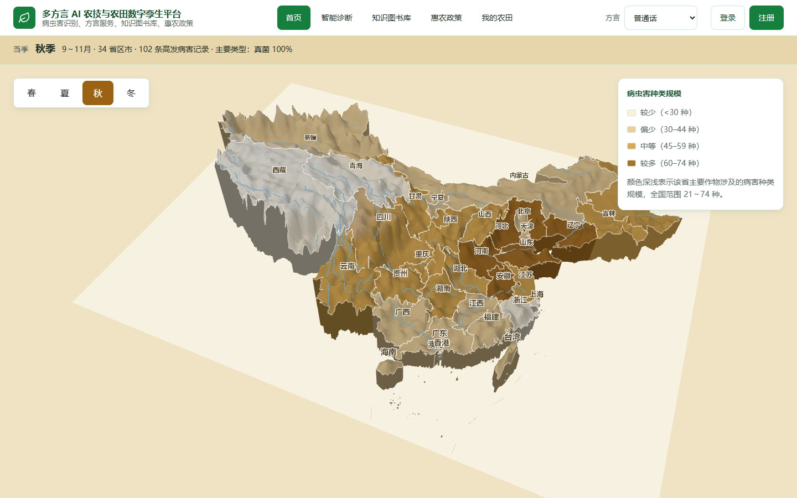
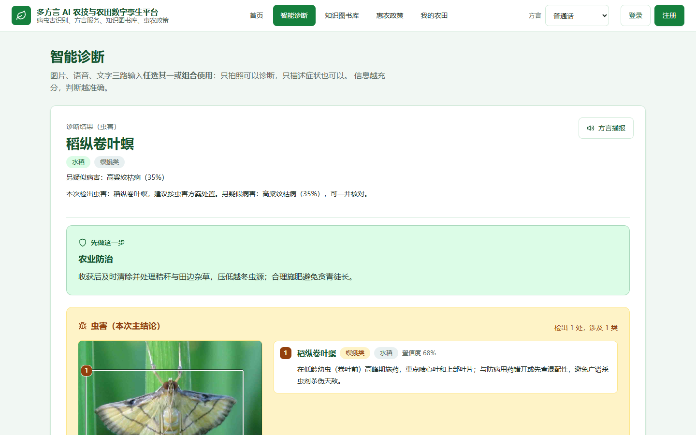
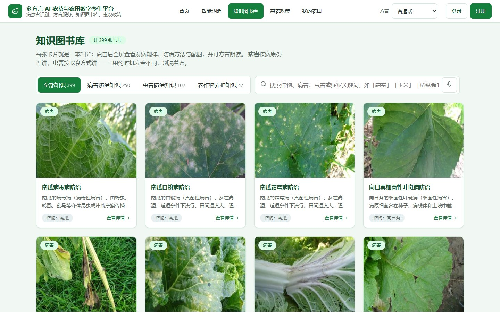
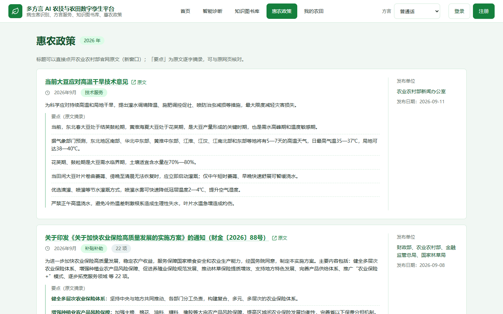
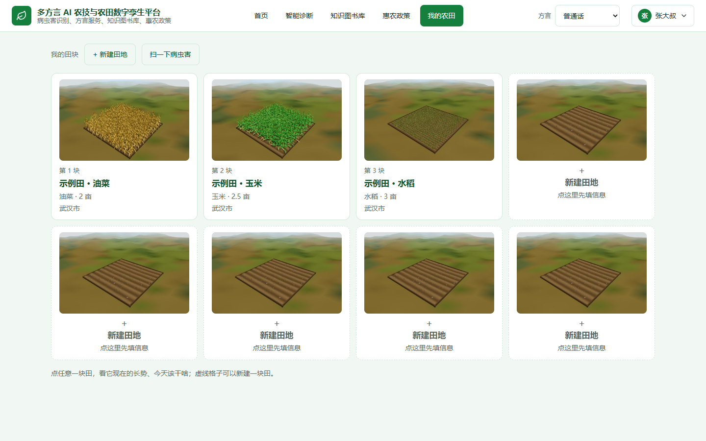
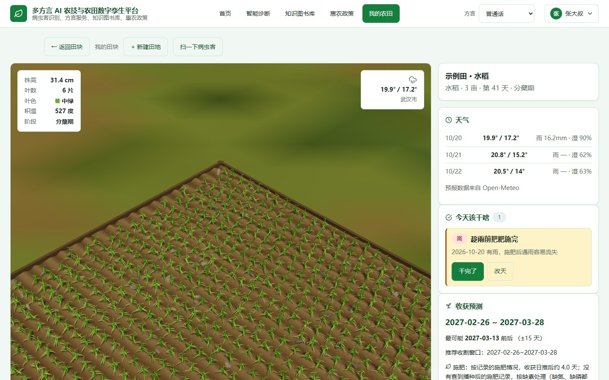
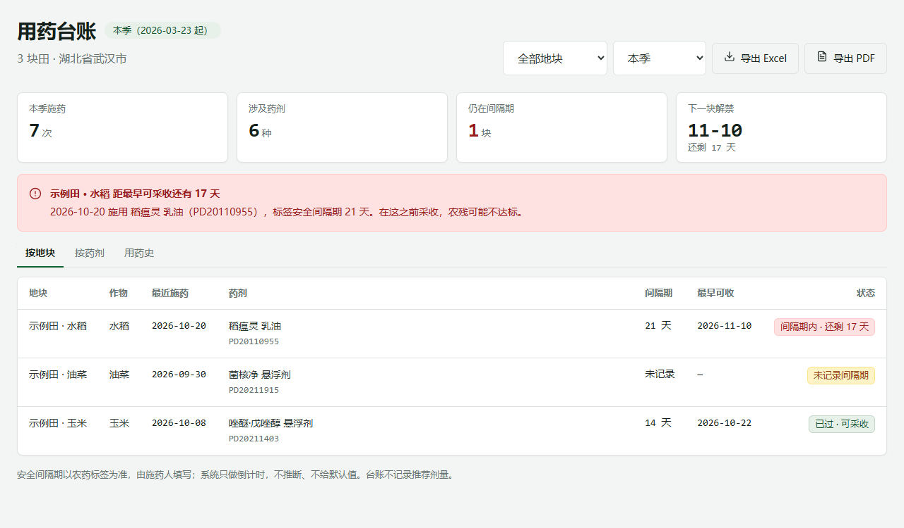
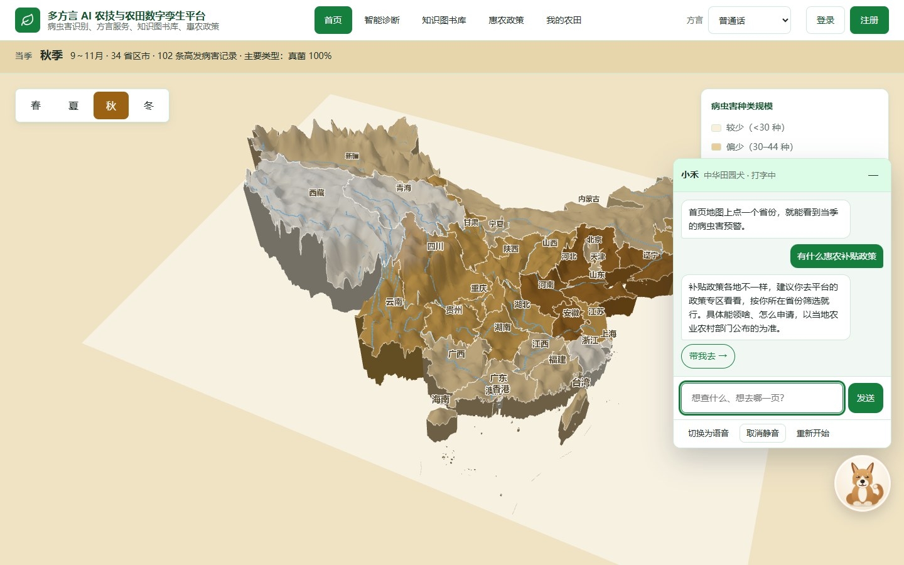

# 田头农技台

面向**基层农技员、农资店与合作社技术员**的病虫害问诊与农户管理工具。在田间拍摄一张照片、说一句方言，
即可获得诊断结论与处置建议，并完成回访排期与一页纸问诊单的生成。

（2026 AIC「AI+场景创新」参赛作品，原名「多方言 AI 农技与农田数字孪生平台」，编号 AIC-2026-86710261。）

在线演示的搭建方式见 [在线演示指南](在线演示指南.md)。

---

## 一、功能概览

| 模块 | 能做什么 |
|---|---|
| 三维首页沙盘 | 以中国地图展示各省当季病虫害 TOP3，支持四季切换，点击可跳转至对应知识卡片 |
| 智能诊断 | 图片、方言语音、文字三路输入，融合后输出诊断结论、防治方案、用药提醒与知识库引用 |
| 知识图书库 | 399 张知识卡片，覆盖病虫害防治与作物养护，支持关键词检索与语音检索 |
| 惠农政策 | 收录农业农村部官网的惠农政策原文与摘要，可按类型、时间、关键词筛选 |
| 我的农田 | 田块管理、积温生长模拟、三维长势、天气与农事提醒、收获期区间预测 |
| 问诊单交付 | 一页纸问诊单：可打印、可复制为微信消息、可下载 A4 PDF、可生成二维码与短链 |
| 回访队列 | 诊断时设定的回访日到期后进入待办队列，过期单独成组，完成即移出 |
| 技能接口 | 将病虫害诊断、农田生长与三维参数封装为两个可复用技能，提供 HTTP 接口、命令行与教程页 |
| 方言语音 | 8 种方言的语音识别与合成，贯穿诊断、检索、记账等场景 |
| 账号体系 | 注册登录、资料与密码管理、账号注销，农田数据按用户隔离 |

---

## 二、功能详解

### 1. 首页 · 病虫害地图



以三维中国地图为底图，按省份显示当季高发的三种病虫害。地图支持春夏秋冬四季切换，
切换时省份底色、省名颜色与风险图例同步变化。悬停省份弹出卡片，点击 TOP3 中的任一条目，
直接跳转至知识图书库并展开详情。

底图地理数据随前端一并打包，首屏不请求外部服务。

### 2. 智能诊断



诊断页提供三种输入方式，可单独使用，也可组合提交：

- **拍照或上传图片**：支持调用摄像头实时取景，也可从相册或文件中选择
- **方言语音**：直接说出作物与症状，系统自动转写
- **文字描述**：补充现场信息

系统合并三条线索后给出结论。报告包含主诊断结论与置信度、防治方案分节正文、用药提醒、
知识库引用来源与判断依据。若上传照片中检测到害虫，虫害成为本次主结论，
防治方案与用药提醒同步切换至虫害内容。

诊断结果可一键记入「我的农田」，写入该田块的病虫害档案。

语音输入支持上传本地音频，覆盖 MP3、M4A、AAC、OGG、Opus、FLAC、WebM、AIFF、WAV 等格式：
前端在浏览器内完成解码与重采样，统一转为 16 kHz 单声道 WAV 后提交，无需用户自行转码。

### 2.1 一页纸问诊单

结论生成后可输出一张问诊单，固定六段：现场情况、诊断结论、处置建议、用药提醒、回访安排、
本省当前高发（标注为演示数据）。四条交付路径覆盖不同现场条件：

| 方式 | 适用场景 | 实现方式 |
|---|---|---|
| 打印 / 存 PDF | 现场交付农户 | 走系统打印对话框，手机与电脑均可存为 PDF |
| 下载 PDF | 微信内无打印入口 | 服务端直接输出 A4（reportlab），可转发或归档 |
| 分享给农户 | 农技员离开现场后 | 生成 30 天有效的只读链接与二维码，农户无需登录 |
| 复制为微信消息 | 仅需发送文字 | 纯文本加序号，控制在手机两屏以内 |

分享内容为**快照**：仅包含该问诊单的文字，不含原图，也无法读取该用户的其它数据；
链接 30 天过期，二维码为矢量图。问诊单**不提供用药剂量**，剂量以农药登记标签与当地植保部门指导为准。

### 3. 知识图书库



共 399 张卡片，分为三类：

| 分类 | 数量 | 内容 |
|---|---|---|
| 病害防治知识 | 250 | 每种病害的病原类型、症状特征、防治要点 |
| 虫害防治知识 | 102 | 每种害虫的取食方式类群、形态特征、防治要点 |
| 农作物养护知识 | 47 | 按作物大类的栽培与养护要点 |

列表支持关键词检索与语音检索，方言识别结果自动填入搜索框。点击卡片打开全屏详情，
按分节展示正文与配图。

### 4. 惠农政策



收录 10 篇农业农村部官网的政策原文，并自动提取摘要。页面支持按政策类型、发布时间与关键词筛选，
原文与摘要均在站内查看，不跳转外部链接。

### 5. 我的农田



「我的农田」将一次性诊断延伸为全周期管理。页面左侧为三维田块视图，右侧为信息面板。

进入田块后的三维长势：



- **田块管理**：新建、编辑、删除田块，记录作物、播种日期与位置
- **三维长势**：根据积温进度渲染植株形态，包括株高、叶片数、叶色、穗的形态，支持旋转与缩放
- **生长模拟**：按有效积温模型推算当前生育阶段，并给出该阶段的农事提示
- **收获预测**：输出收获日期区间而非单一日期，并说明区间的推算方式
- **天气与提醒**：今日与未来两天的天气，以及当日需要注意的农事
- **语音记账**：口述一句话即可记录农事，系统解析田块、农事类型与数量，确认后写入
- **采收约束**：记录「打药」时可选登记药剂并填写安全间隔期，田块卡顶部随即显示隔离期提示

新注册账号自动获得三块覆盖不同作物与生长阶段的示例田，便于直接体验完整功能。

### 5.1 用药台账与安全间隔期

安全间隔期只印在农药瓶身标签上，公开数据中没有可用答案。系统因此**不做推断、不给默认值**，
只完成一道加法：

```
施药日 + 标签上的间隔期 = 最早可采收日
```

界面入口位于「我的农田」工具栏的「用药台账」。

**记录环节**：选择「打药」后，「记一笔农事」增加两个字段——药剂（从 3253 条农药登记证中检索）
与安全间隔期（天）。填写后立即显示「最早可采收 2026-11-10」，无需事后补录。

**田块提醒**：田块存在处于间隔期内的记录时，卡片顶部显示提示条，注明施药日期、药剂名称、
解禁日期与剩余天数，解禁当日自动消失。

**问诊单**：在第六段「本省当前高发」之后接一节「本地产收提醒」，写明该田块最近一次施药、
标签间隔期天数与最早采收日。将被追问的采收时间与用药建议印在同一张纸上，减少事后电话确认。

两种「不显示」属于刻意设计：问诊单未关联田块，或该田块没有任何带间隔期的记录。
后一种情况下，任何日期都只能是推测。

**用药台账页**



三个视图与四个汇总数：

| 视图 | 回答的问题 |
| --- | --- |
| 按地块 | 每块田当前能否采收、上次施用何种药剂、剩余天数 |
| 按药剂 | 该药一季施用次数、涉及田块、**是否连续两次使用同一有效成分**（抗性轮换提醒） |
| 用药史 | 每条施药记录的时间线，逐条标注解禁日 |

汇总数为「施药次数 / 药剂种类 / 仍在间隔期 / 未记录间隔期」，最后一项独立成档：

- **在间隔期** → 红色预警，注明解禁日期与剩余天数
- **已过间隔期** → 正常显示
- **未记录间隔期** → 橙色标记，写明「未记录」，**不写「可采收」**

这一档必须独立存在。将「未记录」显示为「可采收」，等于用默认值替农户做出其无法核实的判断。

台账支持按地块与时间区间筛选。筛选只影响统计与时间线，不影响「是否仍在间隔期」的判定；
否则将区间调整为「本月」，处于隔离期的田块会错误显示为可采收。

导出两种格式：

- **Excel**：四个工作表（按地块 / 按药剂 / 用药史 / 说明），状态列以红底标记
- **A4 一页纸 PDF**：三段表格加签字栏，可直接打印张贴或交付收购方

台账不记录推荐剂量。剂量以标签与当地植保指导为准。

### 6. 方言语音交互

支持普通话、粤语、四川话、河南话、东北话、湖南话、陕西话、台湾话共 8 种。

语音识别采用科大讯飞方言大模型，一个 `accent=mulacc` 模型覆盖 202 种方言，无需用户手动切换。
语音合成按方言选择对应发音人，诊断结论与政策摘要均可方言播报。语音输入在识别后仅做农业术语匹配，
不改写原意。

### 7. 账号与数据隔离

用户名加密码注册登录，密码经 PBKDF2 加盐哈希存储。会话使用 HttpOnly Cookie，前端不接触令牌，
有效期 7 天。田块、农事记录与诊断档案按用户隔离，跨用户访问统一返回 404。
个人中心支持修改昵称、修改密码与注销账号。

### 8. AI 助手 · 小禾



页面右下角常驻中华田园犬「小禾」。点击后可选择交流方式：

- **打字**：输入一句话，小禾以文字回答，并以方言语音播报
- **聊天**：点击麦克风说话，识别后同样回答与播报

小禾可识别页面跳转意图。输入「查一下玉米大斑病」「有什么惠农补贴」「今天该干啥农活」，
它给出回答并附「带我去」按钮，点击跳转至知识图书库、惠农政策或我的农田。

交流方式在标签页关闭前保持不变，跨页面有效；顶部可随时切换打字与语音，也可静音或重新开始。
待机时小禾有呼吸、摇尾与眨眼动作，说话时口型开合，思考时歪头。小禾出现在六个功能页，
登录、注册与个人中心不加载；切换页面时只保留右下角头像，面板需点击展开。

---

## 三、快速开始

环境要求：Python 3.11（本项目验证版本），Windows、macOS、Linux 均可。
仓库已包含推理模型、知识库与前端资源，无需另外下载模型。

以下命令均在项目根目录执行。

### 方式一：使用 conda

```powershell
# 首次使用先创建环境
conda create -n az python=3.11 -y
conda activate az

# 把仓库中的运行时资源铺到程序读取的位置，只需执行一次
python scripts\53_prepare_runtime.py

# 安装依赖；requirements-rag.txt 是知识库检索所需，约 1 至 2 GB
python -m pip install -r requirements.txt
python -m pip install -r requirements-rag.txt

# 启动
.\start.ps1
```

### 方式二：不使用 conda

```powershell
# 先确认 Python 版本；若不是 3.11，用 py -3.11 指定解释器
python --version

python -m venv .venv
.\.venv\Scripts\Activate.ps1

# 若提示「无法加载文件，因为在此系统上禁止运行脚本」，先放开当前会话的执行策略
#   Set-ExecutionPolicy -Scope Process -ExecutionPolicy Bypass

python -m pip install --upgrade pip

# 只运行、不训练时先装 CPU 版 torch，避免 pip 拉取约 2 GB 的 CUDA 版本
python -m pip install --index-url https://download.pytorch.org/whl/cpu torch torchvision

python -m pip install -r requirements.txt
python -m pip install -r requirements-rag.txt

python scripts\53_prepare_runtime.py
.\start.ps1
```

macOS 或 Linux 下，激活命令为 `source .venv/bin/activate`，启动命令改为
`python scripts/20_run_backend.py`。

### 方式三：环境已就绪

```powershell
python scripts\20_run_backend.py
```

启动后：

| 入口 | 地址 |
|---|---|
| 前端首页 | http://127.0.0.1:8000/ |
| 我的农田 | http://127.0.0.1:8000/farm.html |
| 接口文档 | http://127.0.0.1:8000/docs |
| 服务状态 | http://127.0.0.1:8000/api/health |

演示账号：`user`，密码 `nihao123`。每个部署实例在数据库初始化时自动创建该账号，
登录后可直接查看三块示例田；页面仍然要求登录或注册，普通用户注册不受影响。

首次启动自动创建农田数据库。`start.ps1` 依次检查解释器、依赖与数据产物并打印每一步结果；
若提示「数据集划分缺失」，属于训练期产物缺失，不影响页面功能。

`.env` 不存在时，`start.ps1` 会从 `.env.example` 复制一份模板。

---

## 四、使用指南

### 诊断一次病虫害

1. 打开「智能诊断」，上传作物照片，或用方言描述症状
2. 补充文字描述，例如「叶片上有褐色斑点，边缘发黄」
3. 提交后查看结果：主结论、置信度、防治方案、用药提醒与知识库引用
4. 需要留档时，点击「记入我的农田」并选择田块

若照片中检测到害虫，页面在「先做这一步」之后显示虫害区块，列出检测框与对应防治建议。

### 新建一块田

1. 注册或登录后进入「我的农田」
2. 点击田块区域的「新建田块」，填写作物、播种日期与位置
3. 保存后左侧三维视图与右侧信息面板同步刷新
4. 日常可用语音记账：「昨天给水稻施了 20 斤尿素」，解析后确认即可

### 查询一条政策

1. 打开「惠农政策」
2. 按类型或时间筛选，或在搜索框中输入关键词
3. 点击条目查看原文与摘要

### 检索一条病害知识

1. 打开「知识图书库」
2. 在搜索框中输入病害名或作物名，也可点击麦克风用方言检索
3. 点击卡片查看分节正文、病原类型与配图

---

## 五、接口一览

统一响应包为 `{"code": 0, "msg": "ok", "data": {...}}`，`code != 0` 时 `msg` 为中文错误说明。

| 方法 | 路径 | 说明 |
|---|---|---|
| POST | `/api/diagnose/image` | 上传图片，返回 Top-5 候选 |
| POST | `/api/diagnose/multimodal` | 图片、语音、文字三路融合诊断 |
| POST | `/api/diagnose/ask` | 针对诊断结果追问 |
| GET | `/api/library` | 知识卡片列表（分类、检索、分页） |
| GET | `/api/library/{id}` | 卡片详情 |
| GET | `/api/map/pest_top3` | 各省 TOP3 病虫害，按季节筛选 |
| GET | `/api/policy/list` | 政策列表，按类型、时间、关键词筛选 |
| GET | `/api/dialect/list` | 方言列表 |
| POST | `/api/voice/tts` | 文本转方言语音 |
| POST | `/api/voice/asr` | 语音转文本（接收 16 kHz 单声道 WAV/PCM） |
| GET | `/api/health` | 各能力可用状态 |
| POST | `/api/admin/reload` | 清缓存重载模型与数据，仅管理员可用 |

「我的农田」相关接口需要登录：

| 方法 | 路径 | 说明 |
|---|---|---|
| POST | `/api/auth/register` | 注册（自动登录并预置示例田） |
| POST | `/api/auth/login` | 登录 |
| POST | `/api/auth/logout` | 退出登录 |
| GET | `/api/auth/status` | 当前登录状态 |
| GET / PATCH | `/api/auth/me` | 我的资料 |
| POST | `/api/auth/change_password` | 修改密码 |
| DELETE | `/api/auth/me` | 注销账号 |
| GET / POST | `/api/farm/fields` | 田块列表 / 新建田块 |
| PATCH / DELETE | `/api/farm/fields/{id}` | 修改 / 删除田块 |
| GET / POST | `/api/farm/logs` | 农事记录 |
| GET | `/api/farm/today` | 天气、生长、收获、提醒、历史与叙述 |
| GET | `/api/farm/growth/{id}` | 积温与生育阶段 |
| GET | `/api/farm/model/{id}` | 三维植株参数 |
| POST | `/api/farm/attach_diagnosis` | 诊断入档 |
| POST | `/api/farm/voice_parse` | 解析一句话，不落库 |
| POST | `/api/farm/voice_reparse` | 修改文字后重新解析 |
| POST | `/api/farm/harvest_mark` | 记录一次收获 |
| POST | `/api/farm/reminder_snooze` | 某条提醒暂缓两天 |
| GET | `/api/farm/pesticides` | 按防治对象 / 作物 / 药名检索农药登记库 |
| GET | `/api/farm/ledger` | 用药台账（按地块 / 按药剂 / 用药史 + 汇总与预警） |
| GET | `/api/farm/ledger/export` | 台账导出，`fmt=xlsx` 或 `fmt=pdf` |
| GET | `/api/farm/spray/{id}` | 某块田当前的安全间隔期状态 |

### 技能接口

两个按功能封装的模型技能，教程页在 `/skills.html`（导航栏「技能」）。

| 方法 | 路径 | 说明 |
|---|---|---|
| GET | `/api/skills` | 技能清单与可用性 |
| GET | `/api/skills/{name}` | 单个技能的说明、输入输出 JSON Schema、示例 |
| POST | `/api/skills/{name}` | 执行技能 |

`name` 取 `crop-diagnosis`（病虫害检测与多模态诊断）或 `farm-growth`
（农田生长、收获预测与三维参数）。两个接口均为公开调用；请求体上限 30 MB，
单个图片或音频解码后上限 20 MB。

```bash
python -m skills list
python -m skills show crop-diagnosis
python -m skills run farm-growth --input payload.json --pretty
```

`/api/library?category=` 取 `pest`（病害 250 张）、`insect`（虫害 102 张）、`care`（养护 47 张），
留空返回全部 399 条。`pest` 键存放病害，沿用旧名以保持首页深链。

---

## 六、模型效果

### 病害分类

| 指标 | 数值 |
|---|---|
| Top-1 准确率 | 0.8975 |
| Top-3 准确率 | 0.9606 |
| Top-5 准确率 | 0.9777 |
| macro P / R / F1 | 0.6686 / 0.7411 / 0.6917 |
| weighted P / R / F1 | 0.8563 / 0.8975 / 0.8719 |

指标在 761 条测试样本上测得。数据集类别分布不均衡，10 个大类占 7555/10165 张，
261 个小类各 10 张，因此 weighted 指标高于 macro 指标；评估模型时应以 macro 与 Top-3 为准。

### 虫害检测

| 指标 | 验证集 | 测试集 |
|---|---|---|
| mAP50 | 0.6309 | 0.6102 |
| mAP50-95 | 0.4087 | 0.3820 |
| 精确率 | 0.5985 | 0.5431 |
| 召回率 | 0.6132 | 0.6297 |
| 覆盖类别 | 97 / 102 | 96 / 102 |

在 1519 张验证图上，整图识别正确率（取最高置信度的检测框，判断其类别是否命中该图真值）
为 0.7564，Top-5 候选命中率为 0.8381。

导出 ONNX 时执行四道对齐校验：逐像素预处理一致、导出最大绝对误差 1.53e-03、
后处理类别一致、端到端 20 张图最差 IoU 0.9981。

### 收获期预测

分位回归输出 q10 / q50 / q90 三条线，区间经保形校准与宽度控制后交付。数据集覆盖 8 省 65 县，
共 9569 行、1260 组；按组与按时间划分为 5.73 天与 5.58 天；留出湖北省整省盲测（1005 行）为 11.81 天，
积温基线同期为 26.25 天，区间覆盖率（保形校准后）0.714，落在 0.70–0.90 的验收区间内。
逐省轮转的 7 折平均绝对误差为 9.46 天。

---

## 七、部署

### GitHub Codespaces

仓库已包含 `.devcontainer` 配置。创建 Codespace 后自动安装依赖并在后台启动服务，
首次约 8 至 15 分钟。服务监听 8000 端口，转发该端口即可访问。详细步骤见
[在线演示指南](在线演示指南.md)。

### Docker

```bash
docker build -f docker/Dockerfile -t tianyu-zhinong .
docker run --rm -p 8000:8000 --env-file .env tianyu-zhinong
```

镜像以 `python:3.11-slim` 为基础，安装 CPU 版 torch 与运行依赖，推理走 ONNX Runtime，不需要 GPU。
`deploy/hf/Dockerfile` 为适配 Hugging Face Spaces 的版本。

---

## 八、目录结构与技术栈

```
insert\
├─ frontend\          静态页面与本地打包的 ECharts / Three.js / 地图数据
├─ backend\app\       FastAPI 服务
├─ skills\            两个模型技能：SKILL.md、处理函数、注册表与命令行
├─ src\               可复用库：推理、RAG、语音、农田引擎、内容生成
├─ configs\           路径、阈值、作物词表、方言参数
├─ data\              归档图像、划分、标签表、虫害检测集、农田库
├─ knowledge\         农业词库、知识卡片、RAG 文档与向量库
├─ models\            推理模型与模型元数据
├─ scripts\           启动、构建、训练、导出脚本
├─ tests\             单元测试
├─ docs\              数据集说明与论文口径
└─ .devcontainer\     Codespaces 配置
```

依赖方向为 `scripts/` → `src/` ← `backend/`。`src/` 不引用 `backend/`，训练与线上推理共用同一份实现。

技术栈：FastAPI、ONNX Runtime、ChromaDB、YOLOv8、ResNet50、Three.js、ECharts。

---

## 九、关键脚本

| 脚本 | 用途 |
|---|---|
| `20_run_backend.py` | 启动后端服务 |
| `23_init_farm_db.py` | 初始化农田数据库（服务启动时也会自动执行） |
| `07_build_library.py` | 重建知识卡片与 RAG 切分源 |
| `08_build_rag_index.py` | 重建向量索引 |
| `10_train_resnet50.py` | 训练病害分类模型 |
| `13_export_onnx.py` | 导出病害分类 ONNX |
| `16_download_ip102.py` | 下载虫害检测数据集 |
| `17_train_pest_yolo.py` | 训练虫害检测模型 |
| `18_evaluate_pest_yolo.py` | 评估虫害检测 |
| `19_export_pest_onnx.py` | 导出虫害检测 ONNX |

---

## 十、常见问题

**注册后为什么自动有三块田？**
注册时创建示例田，覆盖水稻分蘖期、玉米抽穗期与油菜成熟期，用于直接体验三维长势与积温功能。
属演示数据，可改名或删除。

**收获预测为什么显示的是积温法？**
收获模型需要平台累计 30 条以上收获记录才具备训练条件。记录不足时以积温法推算区间，属设计状态。
记录足够后运行 `scripts\24_train_harvest_model.py`，服务自动切换为模型预测。

**访问别人的田块为什么返回 404？**
跨用户访问统一返回 404 而非 403，避免暴露「该记录存在但不属于当前用户」。删除他人田块同理。

**页面上出现没有内容的空白框？**
这是带有 `hidden` 属性但被作者样式覆盖的元素。`base.css` 已有
`[hidden] { display: none !important }` 兜底；需要显示元素时必须显式设置 `hidden = false`。

**`/api/health` 显示虫害模型未就位，但诊断页能出检测框？**
`main.py` 组装检测器时读取的属性名与实际实现不一致，会抛出 `AttributeError` 并被捕获，
导致状态显示不可用。现由冒烟测试核对状态与模型文件的一致性。若再次出现，查看
`pest_detector` 的 `error` 字段，其中包含原始异常。

---

## 十一、数据与许可

- 病害分类数据集：PDD271，https://github.com/liuxindazz/PDD271
- 虫害检测数据集：IP102，https://github.com/xpwu95/IP102
- 检测模型训练超参参考：PestYOLO，https://github.com/jianxi-Erin/PestYOLO
- 农业病虫害图库：IDADP，http://www.icgroupcas.cn/website_bchtk/index.html
- 政策原文：农业农村部官网，共 10 篇，清单见 `data/policy_list.json`

病虫害训练使用的 `ultralytics` 采用 AGPL-3.0，其传染性覆盖网络服务。本项目将其限制在
`scripts/17~19` 三个脚本中，服务进程不引用它，线上只加载导出的 ONNX。如需闭源商用，
请先评估该许可的影响，或改用非 AGPL 的检测框架重新训练。

IP102 与 PestYOLO 均限定研究用途，相关数据与权重仅供学习与研究。

诊断结果与防治建议仅供参考，不构成用药指令。具体农药品种、剂型与用量，
请以当地植保部门指导、农药登记标签与最新禁限用名录为准。
